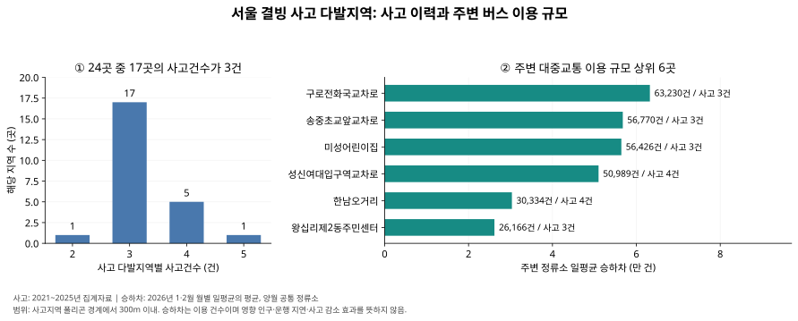

# 얼음땡 — 서울시 결빙 사고지역 분석

**서울시 결빙 사고지역의 교통 이용 여건 분석과 AI 드론 연계 점검 방안**

「AI와 함께하는 교통문제 해결을 위한 데이터 분석 공모전」 분석보고서의 계산 코드, 재현용 공개자료 전처리본, 결과표와 그림입니다.

## 실행

Python 3.12에서 검증했습니다. 이 폴더에서 실행하세요.

```bash
python -m pip install -r requirements.txt
python scripts/build_report.py
python scripts/run_ai.py
python scripts/check_submission.py
```

한글 그래프에는 맑은 고딕(Windows), 나눔고딕(Linux) 또는 Apple SD Gothic Neo(macOS)가 필요합니다. Linux에서는 `fonts-nanum`을 설치할 수 있습니다. 입력 데이터가 포함되어 있으므로 API 인증키나 로그인이 필요하지 않습니다.

## 결과 확인

- [보고서 결과표](results/report_table.csv): 사고지역 24곳의 사고 이력, 주변 정류소 이용 규모, 최근접 병원 직선거리.
- [집계 요약](results/report_summary.json).
- [보고서 그림](results/report_figure.svg). 실행 시 PNG·PDF도 생성됩니다.
- [AI 검증 결과](results/ai/검증결과.json).
- [군집 수 비교](results/ai/군집수_비교.csv), [거리 기준 민감도](results/ai/거리기준_민감도.csv).
- [제출 전 검증 기록](results/submission_check.json): 입력 파일 무결성·결과 수치·공간 집계 확인.
- [최종 보고서 기준 민감도](results/report_sensitivity_summary.csv), [지역별 비교 수치](results/report_sensitivity_values.csv): 거리·월·월별 가중 방식에 따른 이용 규모 비교.
- [검증 범위와 해석 안내](VALIDATION.md).



| 확인 항목 | 결과 |
|---|---:|
| 서울 분석 대상 | 24곳 |
| 사고기록 합계 | 78건 |
| 사상자기록 합계 | 116명 |
| 사고건수가 3건인 지역 | 17곳(70.8%) |
| 구로전화국교차로 주변 일평균 승하차 | 63,230건 |
| 송중초교앞교차로 주변 일평균 승하차 | 56,770건 |
| 미성어린이집 주변 일평균 승하차 | 56,426건 |

## 분석 방법

1. 2021~2025년 집계자료 중 서울 사고지역 24곳을 사용합니다. 서로 중첩되는 집계기간은 합산하지 않습니다. 공식 다발지역 선정 기준은 반경 200m 내 결빙 사고 3건 이상(사망사고 포함 시 2건 이상)입니다.
2. 좌표를 EPSG:5179로 변환합니다. 사고 폴리곤과 정류소 원좌표는 EPSG:4326, 병원 좌표는 EPSG:5174입니다.
3. 사고지역 **폴리곤 내부 및 외곽 경계로부터 300m 이내** 정류소를 추출합니다. 원자료 폴리곤에 300m를 추가하는 기준이며 중심점 반경 300m와 다릅니다.
4. 월별 48개 시간대 승하차 열을 합산하고 정류소별로 집계한 뒤, 1월 31일·2월 28일로 나눕니다. 결과표·그림은 **양월 공통 정류소**의 월별 일평균을 같은 비중으로 평균합니다.
5. 병원·종합병원 283개 기록을 대상으로 사고지역 중심점에서 최근접 시설까지 직선거리를 계산합니다.

## 탐색적 AI와 한계

`scripts/run_ai.py`는 보고서 작성 시 수행한 예비 군집분석을 재현합니다. 사고건수, 사고당 사상자수, 주변 정류소 일평균 승하차, 최근접 병원 직선거리에 `log1p`와 표준화를 적용합니다. K-means의 군집 수 2~4개를 비교합니다. 기본 모형은 `random_state=42, n_init=20`, 반복 학습 50회는 `random_state=0..49, n_init=10`입니다. 지점 하나씩 제외, 거리 기준 100·300·500m 변경, 변수 제외 등도 평가합니다.

예비 AI 입력은 한 달만 관측된 정류소의 다른 달을 0으로 채웠습니다. 최종 결과표는 양월 공통 정류소만 사용합니다. 두 입력은 구분해야 합니다.

군집 2개에서 실루엣 약 0.451, 군집 크기 2/22, 반복 학습 설정 변경 ARI 평균 약 0.445였습니다. **불안정한 군집을 최종 관리 순위로 채택하지 않았습니다.** 코드가 저장하는 모델 파일은 예비 분석 재현용이며 배포용 결빙 탐지모형이 아닙니다.

- 승하차는 교통카드 이용 건수로 고유 인구·도로 통행량·통행 장애의 직접 영향량이 아닙니다. 여러 사고지역에 포함되는 정류소를 지역 간 합산하면 중복됩니다.
- 사고·사상자는 다발지역 기록 합계이며 서울 전체 사고 통계가 아닙니다.
- 병원 거리는 직선거리로 도로 이동시간·응급의료 접근시간을 뜻하지 않습니다. 현황 시설을 과거 시설로 소급하지 않습니다.
- 사고 집계는 2021~2025년, 버스 이용은 2026년 1~2월이며 인과효과를 추정하지 않습니다.
- 드론 탐지모형·현장 실증·최종 도로망 우선순위·사고 감소·탄소 감축량은 구현하거나 입증한 결과에 포함하지 않습니다. 후속 정책·실증 제안입니다.

## 데이터 출처와 전처리

`data/*.csv.gz`는 gzip으로 압축한 UTF-8 CSV입니다. Python/pandas가 자동으로 해제합니다. 원본 전체 인허가 정보 대신 분석에 필요한 좌표·시설유형만 제공합니다. 전송 용량을 줄이기 위해 정류소와 승하차 전처리본은 사고지역 경계 500m 이내 정류소만 수록했습니다. 모든 100·300·500m 분석 대상이 보존되며 전체 정류소 입력과 계산 결과가 동일한지 검증했습니다. 원본 전체 자료의 누락·연결 통계는 공간 필터 적용 전에 산정하여 provenance.json에 기록했습니다.

| 파일 | 출처·범위 | 전처리 |
|---|---|---|
| `accidents.csv.gz` | [한국도로교통공단 결빙 교통사고 다발지역](https://opendata.koroad.or.kr/api/selectFreezingDataSet.do), [공식 코드표](https://opendata.koroad.or.kr/api/down/accidenthazard_codelist_down.jsp) | 집계 코드 2026125(2021~2025), 법정동코드 11로 시작하는 서울 24곳 |
| `stops.csv.gz` | [서울시 버스정류소 위치정보](https://data.seoul.go.kr/dataList/OA-15067/S/1/datasetView.do), 2026-01-08 | 전체 11,237개 중 경계 500m 이내 747개 정류소의 ID·명칭·좌표·유형. 분석 실행 시 한강선착장 제외 |
| `hospitals.csv.gz` | [서울시 병원 인허가 정보](https://data.seoul.go.kr/dataList/OA-16479/S/1/datasetView.do), 확보 시점 현황 | 930개 중 영업중·좌표보유 545개, 그중 병원·종합병원 283개. 좌표·유형만 수록 |
| `bus_daily.csv.gz` | [서울시 버스노선별 정류장별 시간대별 승하차 인원 정보](https://data.seoul.go.kr/dataList/OA-12913/S/1/datasetView.do), 2026년 1·2월 | 월별 원자료 42,282/42,410행의 시간대 승하차 합산 → 정류소별 집계 → 월별 일수로 나눈 일평균 |

원본 CSV의 SHA-256, 행 수와 출처는 [data/provenance.json](data/provenance.json)에 기록했습니다. 전처리본을 원기관 원본 파일로 오인하지 않도록 구분합니다. 데이터 권리는 각 제공기관에 있으며 공개·활용 조건은 위 원출처를 따릅니다.

`provenance.json`의 `source_csv_sha256`는 수집 자료를 UTF-8 CSV로 변환·선별한 로컬 중간 파일의 해시입니다. 제공기관 다운로드 원본의 바이트 해시와 구분합니다. 공개 저장소에 포함된 4개 gzip 파일의 해시는 [data/checksums.json](data/checksums.json)에 별도로 기록했습니다. 이 저장소의 기본 재현 범위는 포함된 전처리본부터 결과 산출까지입니다.

탄소중립 정책 제안의 참고문헌: Stolaroff, J. K. et al. (2018), *Energy use and life cycle greenhouse gas emissions of drones for commercial package delivery*, Nature Communications 9, 409. [DOI](https://doi.org/10.1038/s41467-017-02411-5). 배송 연구의 감축률을 본 사업에 적용하지 않았습니다.
